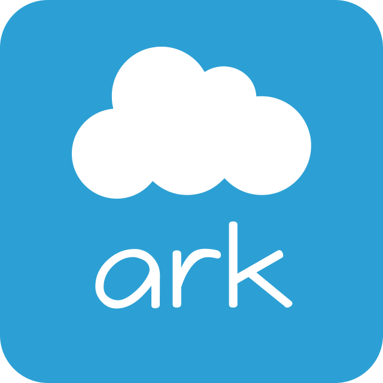

 

  

  <h1>Ark ☁️</h1>

  
A distributed cloud storage system. 
  Your files, your space, your Ark.

  
  

---

## About

**Ark** is an open-source distributed file storage system designed to bring files from different machines together into one unified storage space.

Whether it's documents, photos, application data, backups or other files, Ark aims to provide a simple and efficient way to store and manage them without being tied to a single physical machine.

Instead of relying on one server with a fixed amount of disk space, Ark allows storage to be distributed across multiple machines in different locations. As your needs grow, new storage can be added without changing the way you work with your files.

The project is written in **Go** and is currently under active development.

## Why Ark?

Storage should be easy to expand, efficient to maintain and flexible enough to adapt to different needs.

Traditional approaches to file storage can become inconvenient when dealing with large collections of small files, multiple servers or growing amounts of data. Ark explores a different approach, combining distributed storage with smarter ways of organizing files.

The goal is to build a storage system that is simple to use on the outside while remaining efficient as it grows.

## Features

### ☁️ Distributed by design

Ark separates storage management from the machines that hold your files. Storage nodes can run on different machines and locations, allowing you to build a storage system around the hardware and infrastructure you already have.

### 📦 Smarter file storage

Thousands or even millions of small files can create unnecessary overhead when each one occupies a separate filesystem entry. Ark aims to address this by grouping small files into larger storage containers, making large collections easier to manage.

### 🌍 One unified storage space

Your storage can span multiple machines while remaining part of one system. The goal is to make adding capacity and managing files straightforward, without requiring you to think about where every individual file lives.

### 📈 Grows with your needs

Start small and expand over time. Ark is designed to accommodate additional storage as your collection grows, whether you're building a personal cloud, storing application files or maintaining backups.

### 🛠️ Open source

Ark is being built with Go, with an emphasis on efficiency, maintainability and a straightforward approach to file storage.

## Use Cases

Ark is intended to be flexible enough for different storage needs.

- **Personal cloud** — keep your documents, photos and other files in your own storage environment.
- **Application storage** — store files uploaded by users, including images, attachments and other application data.
- **Backups and archives** — maintain collections of files across your available storage infrastructure.
- **Large file collections** — manage datasets containing many small files without creating a separate physical file for every object.
- **Self-hosted infrastructure** — build a storage system using your own machines rather than depending entirely on a third-party cloud provider.

These are intended use cases, not a statement that every capability is already available.

## Project Status

Ark is a **work in progress**. Its initial development focuses on the core storage functionality and the foundations needed to build a reliable distributed system.

| Component | Status |
| :--- | :--- |
| Core storage | In development |
| Distributed storage | Planned |
| Small-file optimization | In development |
| File management API | Planned |
| Documentation | In progress |

Features and priorities may change as development progresses.

## Getting Started

Ark is not yet ready for general use. Installation instructions, configuration examples and usage documentation will be published when the first usable version becomes available.

For now, you can follow the project's development and explore its source code.

## Contributing

Ideas, suggestions and bug reports are welcome.

If you have an idea that could make Ark more useful, feel free to open an issue and start a discussion. As the project evolves, contribution guidelines will be added for those who want to get involved.

## License

**[MIT License](./LICENSE)**

Copyright (c) 2026-present, Ark project.
